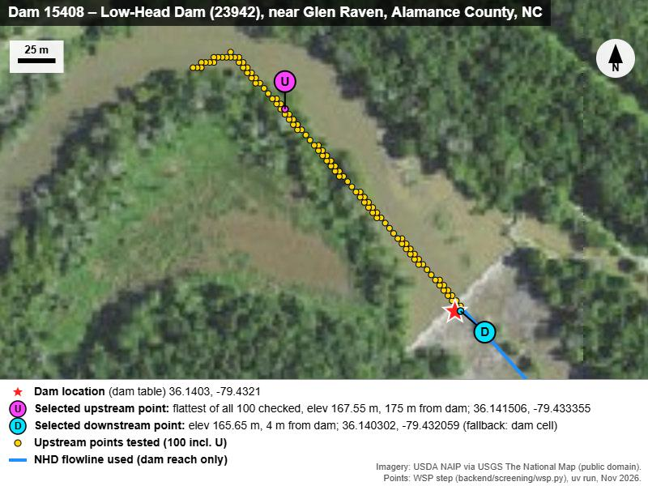
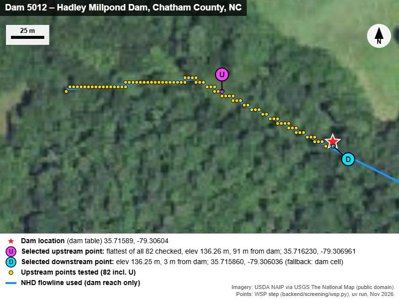

# Future Work

Ideas and known problems to work on later in the low-head dam screening
pipeline. Each idea has its own numbered section; the table of contents and the
summary table below link to every section.

## Contents

- [How to use this document](#how-to-use-this-document)
- [Summary of ideas](#summary-of-ideas)
- [1. Upstream and downstream point selection for the water-surface drop](#1-upstream-and-downstream-point-selection-for-the-water-surface-drop)
  - [1.1 Why it matters](#11-why-it-matters)
  - [1.2 How the points are chosen now](#12-how-the-points-are-chosen-now)
  - [1.3 Examples: dams 15408 and 5012](#13-examples-dams-15408-and-5012)
  - [1.4 Problems found](#14-problems-found)
  - [1.5 Ideas for improvement](#15-ideas-for-improvement)
  - [1.6 Next steps](#16-next-steps)
- [Template for a new idea](#template-for-a-new-idea)
- [Revision history](#revision-history)

## How to use this document

- **Adding an idea:** copy the [template](#template-for-a-new-idea) to the end of
  the numbered sections, give it the next number, then add it to the
  [Contents](#contents) list and the [Summary of ideas](#summary-of-ideas) table.
- **Links:** GitHub builds each heading's link from its text (lower case,
  punctuation removed, spaces become `-`). For example, `## 2. Faster DEM
  downloads` becomes `#2-faster-dem-downloads`. If you rename a heading,
  update its link in the Contents list.
- **Images:** put them in `docs/images/future-work/` and link them with a
  relative path, for example ``.
- **Status values:** `Idea` (not yet planned), `Planned`, `In progress`, `Done`.

## Summary of ideas

| # | Idea | Status | Added | Affects |
| --- | --- | --- | --- | --- |
| 1 | [Upstream and downstream point selection for the water-surface drop](#1-upstream-and-downstream-point-selection-for-the-water-surface-drop) | Idea | 2026-11-19 | Dam height (`Dam_Height_WSP_Ft`) and danger ranges |

---

## 1. Upstream and downstream point selection for the water-surface drop

**Status:** Idea  **Added:** 2026-11-19  **Code:** `backend/screening/wsp.py`,
`backend/run_wsp_pipeline.py` (`_process_dam`), `backend/build_trimmed_dems.py`

Future work is needed to improve how the upstream and downstream points are
chosen along the river, so that the change in water-surface elevation (ΔWSE)
across each dam, and therefore the dam height, is determined more accurately.

### 1.1 Why it matters

The dam height comes from the weir equation:

**P = (ΔWSE + y<sub>T</sub>) − H**

| Symbol | Meaning | Where it comes from |
| --- | --- | --- |
| P | dam height | result |
| ΔWSE | water-surface drop across the dam | DEM elevation at the **upstream point** minus DEM elevation at the **downstream point** |
| y<sub>T</sub> | tailwater depth | rating curve at the median NWM flow |
| H | head over the crest | weir equation, from the flow and crest length |

ΔWSE is the only term read from the DEM, and it depends entirely on the two
selected points. In watershed 030300, the uv and conda runs agree on flow,
tailwater depth and crest length for every dam that succeeded in both; where
their heights differ, the difference comes almost entirely from ΔWSE (H differs
by at most 0.017 m).

### 1.2 How the points are chosen now

1. **Profile.** `sample_dem_along_flowlines` takes every DEM cell that the NHD
   flowline crosses (the dam's reach plus the reach upstream of it, if that
   reach is in the flowline file). Each cell gets a distance `x` from the dam:
   negative upstream, positive downstream.
2. **Upstream point** (`pick_upstream_node`). Walking upstream from the dam,
   within 50 m (`DEFAULT_SEARCH_M_UP`), it takes the first cell whose slope is
   below 0.02 m/m (`DEFAULT_FLAT_THRESHOLD`), meaning the flat pool behind the
   dam. If no cell qualifies, it takes the flattest cell in the window.
3. **Downstream point** (`pick_downstream_node`). Between 10 m and 500 m below
   the dam, it takes the cell whose local slope is closest to the reach's NHD
   slope, meaning where the water surface returns to normal after the
   hydraulic jump. Without a reach slope it uses the cell nearest 75 m. If the
   window has no cells, it falls back to **the cell nearest the dam**.
4. **ΔWSE** = elevation of the upstream point − elevation of the downstream
   point. If ΔWSE ≤ 0 the dam is recorded as `negative_delta_wse` and gets no
   height.

### 1.3 Examples: dams 15408 and 5012

Both dams are in watershed 030300 (North Carolina). The points below are from
the uv smoke-test run of November 2026 (`lhd-staging\parquet-smoke`),
recomputed with the pipeline's own functions; they reproduce the stored ΔWSE
exactly (1.9081 m and 0.0084 m).

| Dam | ΔWSE | Computed height | NID height | DEM coordinate system |
| --- | --- | --- | --- | --- |
| 15408, Low-Head Dam (23942), Alamance County | 1.908 m | 7.67 ft | not listed | EPSG:4269 (degrees), about 3 m cells |
| 5012, Hadley Millpond Dam, Chatham County | 0.008 m | 0.26 ft | **11 ft** | EPSG:4269 (degrees), about 3 m cells |

**Dam 15408.** The downstream point (D) is the cell beside the dam, 4 m away.
All 100 upstream cells were checked; none met the flat rule, so the flattest
one (U, 175 m upstream) was chosen. Over much of this reach the flowline, and
so the sampled cells, appears to cut straight across rather than follow the
curving channel visible in the image.



**Dam 5012.** Again the downstream point is the cell beside the dam (3 m away),
and the flattest of all 82 upstream cells was chosen (91 m upstream). The two
points differ by less than 1 cm in elevation, so the computed height is
0.26 ft, while the National Inventory of Dams lists 11 ft.



*Imagery: USDA NAIP via USGS The National Map (public domain). Interactive
versions of these maps, with every tested point's latitude, longitude and
elevation, are in `lhd-staging\wsp-points\` (`wsp_points_15408_5012.kml` for
Google Earth, plus one CSV per dam).*

### 1.4 Problems found

1. **Distances are in degrees when the DEM is in latitude/longitude.** The
   code uses the DEM's own units for distance (`pixel_m = abs(src.transform.a)`
   and the flowline is projected into the DEM's coordinate system). Both
   example DEMs are EPSG:4269, so every "metre" in the method is really a
   degree:
   - the downstream window of 10–500 "m" is 10–500 degrees, contains no
     cells, and the downstream point falls back to the cell beside the dam;
   - slopes come out in metres per degree (median about 740 and 2,000 for the
     two dams, instead of a few hundredths of a metre per metre or less), so
     the 0.02 flat-pool rule is never met
     and the upstream point is simply the flattest cell;
   - the 50 "m" upstream window covers the whole upstream profile.

   DEMs in metres are not affected; for example dam 3601's DEM is UTM zone 17N
   (EPSG:26917) with 1 m cells. The conda archive's DEMs for these two dams
   are also EPSG:4269, so this is not caused by the move to uv.
2. **Missing neighbouring reaches.** Both flowline files contain only the
   dam's own reach. The upstream reach named in the result (`upstream_comid`)
   and the downstream reach are not in the file, so the profile stops at the
   ends of the dam's reach.
3. **The flowline does not always follow the channel.** NHD flowlines are
   generalised lines. Where the line leaves the visible channel (dam 15408),
   the sampled cells are bank or floodplain elevations, not the water
   surface.
4. **Single-cell picks.** Each point is one DEM cell, so a single noisy cell
   (vegetation, a bank, a bridge) can set ΔWSE.
5. **Silent fallbacks.** Falling back to the cell beside the dam, or to the
   flattest cell, is not recorded in `wsp_result.json`, so these heights look
   as reliable as any other.

### 1.5 Ideas for improvement

| Idea | What it fixes | Effort |
| --- | --- | --- |
| Measure all distances in metres: reproject geographic DEMs to a projected system (for example the local UTM zone) in `build_trimmed_dems.py`, or compute distances geodesically in `wsp.py`; stop with an error if a DEM is still in degrees | Problem 1, likely the largest effect | Small |
| Make sure the flowline file contains the upstream and downstream reaches; re-navigate if not (ties in with the NLDI fixes in `docs/plans/deferred-fixes-after-parquet.md`) | Problem 2 | Medium |
| Sample across the channel instead of along the centreline: at each station, take a short cross-section (about the bankfull width, `owp_tw_bf`) and use its lowest elevation | Problems 3 and 4 | Medium |
| Smooth the profile (moving median over several cells) before computing slopes; use the median elevation of a short stretch instead of one cell | Problem 4 | Small |
| Upstream point: look for the pool beyond a minimum distance from the crest (for example a few dam heights or channel widths) so the drawdown curve over the crest is excluded | More reliable pool elevation | Small |
| Downstream point: start the search beyond the hydraulic jump (a multiple of the expected dam height or channel width); never fall back to the cell beside the dam, mark the dam as failed instead | Problem 1 symptoms, plunge-pool noise | Small |
| Snap the dam location to the flowline and record the snap distance; flag dams that are far from the line | Wrong reach or wrong dam cell | Small |
| Add quality fields to `wsp_result.json`: DEM coordinate system, cells in each window, whether a fallback was used, snap distance, reaches present | Problem 5; lets the website or analysis filter weak results | Small |
| Validate against NID heights where they exist (for example 5012: 11 ft) and review a sample of dams on imagery like the maps above | Measures the improvement | Medium |

### 1.6 Next steps

1. Count how many dams in the full rebuild have DEMs in degrees, and how many
   used the downstream fallback (reading DEM headers and result files only).
2. Fix the distance units (first row above) and rerun watershed 030300;
   compare heights with NID where available.
3. Add the point-export script that produced the maps and KML to the repository
   (for example `scripts/export_wsp_points.py`) so these checks can be
   repeated for any dam.
4. Then work through the remaining ideas, re-checking dams 15408 and 5012 each
   time.

---

## Template for a new idea

Copy everything between the lines, replace the parts in angle brackets, and
add the new section to the [Contents](#contents) and the
[Summary of ideas](#summary-of-ideas) table.

```markdown
## <N>. <Short title>

**Status:** Idea  **Added:** <YYYY-MM-DD>  **Code:** <files involved>

<One or two sentences: what should be improved and why.>

### <N>.1 Background

### <N>.2 Evidence or examples

### <N>.3 Ideas for improvement

### <N>.4 Next steps
```

---

## Revision history

| Date | Change |
| --- | --- |
| 2026-11-19 | Document created; section 1 (upstream and downstream point selection) added. |
